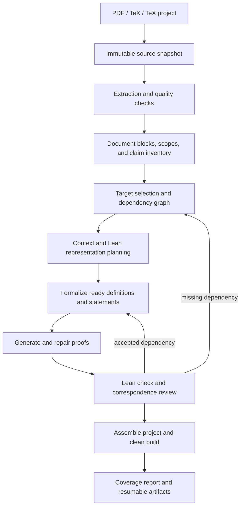

# Proposed pipeline for 10–30-page mathematical papers

Status: design proposal. No application implementation is included.

## 1. Objective and scope

Turn a mathematical paper into a traceable Lean project, building definitions
and supporting results before the selected target theorems. Preserve useful
partial results when the paper cannot be fully formalized.

The unit of input is a paper; the unit of formalization is a mathematical
declaration or a group of mutually dependent definitions. Page count is a
planning signal, not the unit used to divide mathematical content.

Initial scope:

- Digital PDF, standalone UTF-8 TeX, and local TeX projects with an explicitly
  chosen root document. Prefer TeX when both versions are available.
- Definitions, assumptions, notation, numbered/unnumbered results, proofs,
  equations, and references, with exact source locations.
- Main-result mode: selected main theorem(s) and their dependency closure.
- All-results mode: all in-scope theorem-like claims, with explicit exclusions.
- A final Lean build and a report showing coverage, unresolved items, and
  statement correspondence. No promise that arbitrary research mathematics
  can be formalized automatically.

Default proposal: inventory the entire paper, then target its explicitly named
main results. If the main target is ambiguous, present the inventory for user
selection. Do not create a mandatory approval stop for an unambiguous plan.

Scanned PDFs enter a separate OCR path. If that path is unavailable, return an
extraction issue before spending formalization tokens. General diagram
interpretation and automatic acquisition of cited papers are later extensions.

## 2. Architecture



A persistent scheduler drives these stages. Every stage writes versioned
artifacts and records its inputs, outputs, configuration, and status. Extracted
paper content is treated as source data, not as operational instructions.

## 3. Stage contracts

| Stage | Main input | Output | Proceed condition |
|---|---|---|---|
| Ingest | File(s), root, requested scope | Source manifest, hashes, toolchain/config snapshot | Files are readable; root is unambiguous |
| Extract | Source snapshot | Text/math blocks and source mappings | Required content is readable or issues are explicitly resolved |
| Inventory | Blocks and section hierarchy | Definitions, claims, proofs, scopes, notation registry | Targets have source-backed statements |
| Resolve dependencies | Inventory and targets | Typed graph, external-reference registry, unresolved issues | A node has sufficient context and known prerequisites |
| Plan representation | Scope, graph, Mathlib search | Lean names/types/imports and definition choices | Representation preserves the mathematical objects |
| Prepare context | Ready node and verified prerequisites | Exact target plus bounded context package | Required content fits the configured request budget |
| Formalize | Context and fixed signatures | Candidate declaration/proof and attempt records | Candidate is ready for compiler checking |
| Verify and review | Candidate and immutable source target | Compiler result, axiom report, alignment/proof review | Node satisfies the acceptance policy |
| Assemble | Accepted artifacts | Namespaced Lean modules, root import, pinned manifest | Combined project passes a fresh build |
| Report | Inventory and all outcomes | Coverage, provenance, unresolved items, cost/time | Every inventoried claim has a recorded disposition |

### 3.1 Ingest and extraction

Store the original files without editing them. Record source hashes, original
filenames, selected root, configuration, and Lean/Mathlib versions.

For TeX:

- Extend the existing parser to return a whole-document model independently
  of theorem selection and model context limits.
- Resolve `input`, `include`, and supported project-local macro files within
  an explicit project root. Track include order, missing files, cycles, and
  source mappings across files. Do not execute TeX or shell escape.
- Preserve macro definitions, math expressions, theorem environments, and
  scopes. Report unsupported dynamic TeX constructs rather than approximating
  them silently.
- Keep bibliography entries for reference resolution, excluding bibliography
  prose from mathematical generation prompts.

For PDF:

- Preserve page numbers, bounding boxes, reading order, and equation locations
  before text cleaning. Support columns and repeated headers separately.
- Flag missing text, suspect equation extraction, broken symbols, and uncertain
  reading order. A heuristic quality score is a triage signal, not a guarantee.
- Keep raw and normalized versions, with reversible mappings where possible.
- OCR or visual equation recovery must retain the original page crop and mark
  transcription uncertainty. Ambiguous mathematics is not silently accepted.

Extraction can process pages incrementally. Mathematical segmentation happens
after reading-order reconstruction; page boundaries do not divide theorems.

### 3.2 Inventory and scopes

Construct a complete inventory before proving anything. Use parser/layout
evidence first, then targeted LLM extraction for implicit or unnumbered claims.
Every LLM-extracted claim must cite exact source spans.

Store section-level assumptions and binders explicitly. For example, a section
opening with “Let G be a finite group” must affect every applicable theorem,
even if the theorem text does not repeat that assumption.

Attach proofs using labels, titles, proximity, and explicit references. Retain
ambiguous or deferred proof associations as issues. Track prose assumptions
between a theorem and its proof, not just named environments.

Definitions and notation have scope and revision. The same symbol in different
sections must not automatically refer to the same mathematical object.

### 3.3 Dependency graph

Graph nodes include definitions, mathematical claims, scoped assumptions,
external results, and any supporting lemmas introduced during formalization.
Use typed edges:

- `uses_definition`: required to interpret the statement or proof;
- `requires_result`: required to establish the result;
- `inherits_scope`: introduces types, variables, or assumptions;
- `cites`: bibliographic/contextual reference, not automatically a prerequisite;
- `proof_for`: associates a proof block with a claim.

Record whether an edge is explicit, model-inferred, or reviewer-confirmed,
along with source evidence. An inferred prerequisite remains visible until
resolved; textual absence of an edge is not proof of independence.

Resolve external results through exact Mathlib searches and type checking. A
similar theorem name or embedding match is only a candidate. If the external
result is unavailable, create a separate formalization task or an unresolved
dependency. Do not invent an axiom to unblock a proof.

Topologically schedule acyclic dependencies. Examine strongly connected groups:
merge genuine mutual definitions, use a supported mutual proof strategy where
appropriate, or report an unresolved cycle. Never assume a cyclic theorem in
order to prove itself.

If compiler feedback or proof analysis discovers a missing lemma, revise the
graph, revalidate it, and schedule that lemma. Bound graph expansion and record
whether the lemma came from the paper or was introduced by the formalizer.

### 3.4 Representation and statement preparation

Map paper concepts to existing Mathlib structures before creating new ones.
Record representation choices consistently across the paper: types, coercions,
notational conventions, namespaces, and correspondences between definitions.

Prepare definition/type declarations first. For each theorem, elaborate the
proposed proposition in a temporary signature-checking harness, without an
unproved declaration becoming an importable dependency. A type-correct
signature establishes that the statement is meaningful Lean; it is not a proof.

Review the proposed signature against source assumptions, quantifiers, domains,
and conclusion. Freeze its accepted revision before proof generation. Repair
loops may change the proof/imports, but changes to the theorem type return to
statement review and invalidate affected downstream artifacts.

A smaller or weaker result may be offered as a separate, explicitly scoped
target. It never replaces the inventoried paper claim or counts as its success.

### 3.5 Context packages and long proofs

Do not submit the whole 10–30-page paper to every LLM call. Each context package
contains:

1. Exact target statement, relevant source locations, and complete assumptions.
2. Required definitions, notation, and macro meanings.
3. Verified dependency signatures, module imports, and necessary usage examples.
4. The source proof or the relevant exact source-proof segment.
5. A small, ranked set of applicable Mathlib/memory hints.

Use the configured model's context capacity, reserving space for system
instructions, output, and later repair diagnostics. Count the full serialized
request with a supported tokenizer when possible. With an unknown tokenizer,
use a documented conservative estimate and record that it is an estimate.

Required hypotheses, formulas, and target statements are never truncated.
Drop optional examples first. If required content still does not fit, split
the proof along mathematical subclaims, prove helper lemmas, and reference
their checked signatures. If the statement itself cannot fit, report a budget
issue instead of changing the target. Summaries help routing and planning;
they do not replace authoritative source mathematics.

The existing 48,000-character limit can remain for the legacy single-input
API. The paper path needs separate document-ingestion limits and per-request
context budgets, so a long document can be processed in smaller units.

### 3.6 Formalization, compilation, and acceptance

Reuse the current candidate generation, compiler diagnostics, repair, and
ranking logic behind an explicit unit interface. Supply frozen statement types,
verified dependency modules, the context package, and per-unit budgets.

Use isolated scratch paths for every paper, node, revision, and attempt:

```text
scratch/<paper-id>/<node-id>/<revision>/<attempt-id>/Candidate.lean
```

All statement checks, candidate checks, repair checks, and final checks use
this isolation. Retaining isolation only for the main verification loop is
insufficient. Publish accepted modules atomically through a single writer.

Track independent dimensions of outcome:

| Dimension | Example states | Meaning |
|---|---|---|
| Compilation | pending / passed / failed / timeout | Lean checked the exact recorded code and dependency revisions |
| Statement correspondence | unchecked / model-reviewed / human-reviewed / mismatch | How the formal statement was compared with the paper |
| Proof correspondence | reconstructed / source-traced / gap / unknown | Whether the paper's proof steps are represented |
| Assumptions | audited / unexpected / unresolved | Dependencies and assumptions used by the compiled result |

Successful compilation does not prove that translation from prose was correct.
The UI and report must keep these dimensions distinct. Preserve the current
compiler-derived `success` for legacy calls; paper outcomes use explicit
coverage and review states rather than overloading that boolean.

Reject `sorry`, `admit`, new unproved mathematical axioms, and dependencies on
unfinished project artifacts. Audit the target's actual axiom dependencies;
report expected Lean foundations separately from newly introduced assumptions.
Checking for one forbidden token is not a complete trust audit.

Only nodes that compile, pass the project's axiom policy, and have no known
statement mismatch can become accepted dependencies. Mark their correspondence
review level. A verified but mismatched result is quarantined from downstream
proofs. Ambiguous assumptions block the affected unit, while independent units
continue. Human review is requested for material ambiguity or a user-selected
review policy, not after every successful compiler run.

An alternate Lean proof can establish the target theorem while failing to
validate the author's original argument. Report that distinction explicitly.

### 3.7 Assembly and final reporting

Generate stable, namespaced modules such as:

```text
PaperFormalization/
  Definitions.lean
  Results/Result_<id>.lean
  Main.lean
source_manifest.json
claim_inventory.json
dependency_graph.json
report.json
report.md
```

`Main.lean` imports accepted targets and their actual checked dependencies.
Build the assembled project with pinned Lean/Mathlib versions, including a
fresh build without stale generated artifacts before final delivery. The
published project contains no unproved placeholders for excluded results.

The report distinguishes:

- Claims discovered in the paper, claims selected, and claims excluded with reasons.
- Selected claims compiled, pending review, blocked, failed, or budget-limited.
- Definition coverage and source-to-Lean mappings.
- Main targets and whether their complete dependency closure is accepted.
- Correspondence review level and proof-tracing coverage.
- Extraction issues, external dependencies, axiom audit, time, and token usage.

For example, “8 of 12 selected claims compiled; 2 await statement review; 2 are
blocked by Lemma 4” is preferable to “paper verified.” An all-results completion
claim requires reconciled inventory coverage and the declared review policy;
it does not assert machine-proved equivalence between prose and Lean.

## 4. Persistence and scheduling

Use local SQLite in WAL mode for paper metadata, nodes, edges, job states,
attempts, events, budgets, and memory indexing. Store large source/code/log
artifacts as immutable files with checksums. Transactional writes replace
concurrent read/modify/rewrite operations on JSONL memory files.

Minimum entities:

| Entity | Required fields |
|---|---|
| Paper | stable ID, source revision/hash, root, requested targets, toolchain/config hash |
| SourceBlock | stable ID, revision, kind, exact text, spans, section/scope, labels, extraction issues |
| MathUnit | stable ID, revision, source block IDs, kind, target signature, assumptions, disposition |
| DependencyEdge | source/target unit revisions, kind, evidence, resolution state |
| Attempt | unit revision, attempt ID, request hash, code/log artifacts, dependency hashes, outcome, usage |
| Job | state, lease owner/expiry, retry policy, budgets, cancellation flag, timestamps |
| AcceptedArtifact | unit revision, module/name, code hash, dependency hashes, toolchain, compilation and review records |

Stable identity and content revision are separate. Re-importing an edited
paper creates new revisions and reconciles labels/source locations. Ambiguous
identity matches require resolution; line numbers alone are not identity.

Execution states:

```text
pending -> ready -> running -> succeeded
                        |-> retry_pending
                        |-> failed
                        |-> needs_review
pending/ready ----------|-> blocked_dependency
pending/ready/running --|-> cancelled
```

Completion and retry writes are transactional. A worker leases a job; expired
leases are recovered after restart. Work may execute more than once after a
crash, but artifact publication and state transitions must be idempotent and
reject a stale worker's publication.

Separate budgets for the paper, each unit, each model request, and each Lean
check. Queue waiting does not consume a unit's execution timeout. The paper
budget still includes total elapsed time and cumulative cost.

Start with one Lean worker and at most two LLM requests globally. This is a
conservative configuration to measure, not a throughput guarantee. Increase
only after observing memory use and provider limits. Apply both request and
token-rate controls globally, including candidate generation and repairs.

Retry transient rate-limit/network errors with bounded exponential backoff,
jitter, and `Retry-After` where available. Do not repeatedly retry malformed
source, exhausted quota, or an unchanged compiler failure. Pause downstream
work on exhausted budget; retain independent completed artifacts.

Cache keys include exact source/context/signature hashes, prompt/parser
versions, generation settings, dependency artifact hashes, and toolchain.
Revalidate downstream artifacts after statement, definition, dependency, or
toolchain changes. Memory matches are hints until rechecked against the current
target and environment.

## 5. User workflow and interfaces

Proposed commands, not yet implemented:

```text
paper analyze <input> --root <main.tex> --output <directory>
paper plan <paper-id> --target thm:main
paper run <paper-id> --scope main-results
paper run <paper-id> --scope all-results
paper status <paper-id>
paper resume <paper-id>
paper cancel <paper-id>
paper export <paper-id> --output <directory>
```

Analysis produces the inventory, extraction issues, and an initial dependency
plan without starting proof generation. Estimates distinguish deterministic
counts from uncertain time/cost forecasts. User review of this plan is available;
it is not mandatory when an already authorized run has unambiguous targets.

The web UI uses the same orchestrator and persistent state. Show source pages
or lines beside each mathematical unit, target/dependency status, compiler and
correspondence results, usage, and resume controls. A paper overview reports
claim coverage, not just a progress percentage.

## 6. Mapping to the current code

| Existing component | Proposed change |
|---|---|
| `latex_extract.py` | Reuse parser; separate whole-document parsing from selection; add source scopes/project resolver |
| `extract.py` | Add PDF blocks with page/bounding-box provenance and quality issues; retain legacy text API |
| `structure.py` | Keep single-claim decomposition; add document inventory and source-backed scope extraction separately |
| `models.py` | Retain legacy result types; add paper, source block, unit, edge, attempt, and review records |
| `pipeline.py` | Retain single-target entry point; expose a unit executor with fixed signature/dependency inputs and isolated workspace |
| `lean_verify.py` | Reuse compiler/repair; support per-attempt files, dependency builds, axiom audit, and final project check |
| `memory.py` | Migrate writes to transactional storage; revalidate retrieved artifacts; retain import/export of JSONL |
| `webapp.py`, `cli.py` | Add paper APIs/commands backed by the same durable scheduler |

Suggested new modules: `paper_pipeline.py`, `document_models.py`,
`document_extract.py`, `dependency_graph.py`, `context_builder.py`,
`paper_store.py`, `scheduler.py`, and `project_builder.py`.

Do not pass concatenated paper chunks through `formalize(text=...)` and call
that whole-paper support. The existing executor needs explicit dependency and
workspace interfaces before it can reliably serve the orchestrator.

## 7. Implementation phases and acceptance criteria

### Phase 1: document analysis and reviewable plans

Build the paper/source schema, immutable artifacts, inventory/scopes, typed
dependency graph, target selection, and analysis report. Start with digital
PDF and standalone TeX; add project-local TeX includes with source mapping.

Accept when fixtures demonstrate cross-page proofs, section assumptions,
custom macros, forward references, multiple claims, and explicit reporting of
missing/ambiguous source content. No generation-stage context limit rejects
an otherwise valid paper during ingestion.

### Phase 2: dependable execution foundation

Add transactional storage, job leases/resume, isolated compiler paths, global
resource limits, budgets, and revision-aware cache invalidation.

Accept when a forced restart loses no committed result, retries do not publish
duplicates, a stale worker cannot overwrite a newer artifact, and simultaneous
jobs cannot alter each other's Lean files or memory records.

### Phase 3: dependency-aware main-result formalization

Add representation planning, definition/signature stages, bounded context,
dependency imports, proof decomposition, review states, and target closure.

Accept when a fixture main theorem genuinely imports its checked local lemma,
a changed upstream definition invalidates dependent results, and a deliberately
weakened statement is flagged rather than counted as the original theorem.

### Phase 4: whole-paper assembly and coverage

Add all-results mode, final project builds, source-to-Lean exports, axiom
reports, and explicit partial completion. Finish CLI/web paper workflow.

Accept when inventory exclusions remain visible, a paper with a failed lemma
reports affected targets as blocked, and an assembled project rebuilds from
its pinned sources without hidden scratch dependencies or `sorry`.

### Phase 5: pilot and optional extraction expansion

Evaluate representative papers of approximately 10, 20, and 30 pages. Include
at least one paper close to existing Mathlib concepts, one with new definitions,
and one with substantial dependency structure. Compare TeX and PDF extraction
where both are available. Add scanned-PDF OCR after core correctness is stable.

Measure inventory precision/recall against a reviewed inventory, source mapping
accuracy, inherited-assumption preservation, exact-target compilation coverage,
review level, dependency closure, retry/recovery behavior, memory use, token
usage, and elapsed time. Record denominators and reasons for exclusion.

The pilot establishes realistic limits and tuning. Neither page count nor unit
test success supplies a research-paper formalization success rate in advance.

## 8. Recommended first deliverable

Implement Phase 1 first: a paper analysis command that produces a source-linked
claim inventory, dependency plan, and unresolved-issue report for a 10–30-page
paper. That makes the paper interpretation concrete and reviewable before
spending tokens on proofs. Follow with Phase 2 before enabling parallel work.
